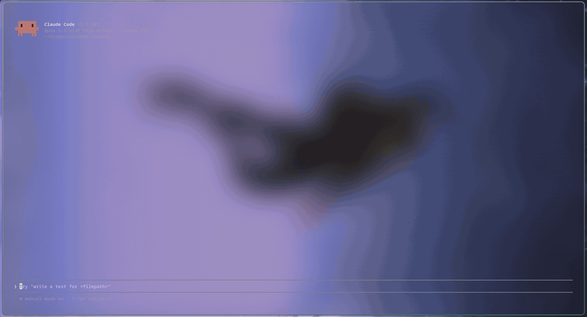

# ventana

*[Read in English](README.md)*

<!-- Demo: grábala y guárdala como docs/demo.gif, luego quita estas marcas de comentario.

-->

Un mod de Claude Code para Linux que abre una ventana nativa al lado de la terminal. Sigues trabajando con Claude en la terminal como siempre; la ventana muestra el chat y lo que pasa en la sesión, y también te deja escribirle a Claude desde ahí.

No reemplaza la terminal ni abre un segundo Claude: se engancha a la sesión que ya tienes corriendo, así que la terminal y la ventana muestran siempre la misma conversación.

Escribe `/ventana` en una sesión para abrirla, o abre todo directo con el comando `claude-ventana` (ver [Lanzador](#lanzador)).

## Qué tiene

- **Chat:** tus mensajes y las respuestas de Claude. Lo que escribes ahí se envía directo, como si lo teclearas en la terminal. Incluye atajos editables.
- **Permisos y preguntas:** cuando Claude pide permiso para algo, te hace preguntas con opciones o termina un plan, sale una tarjeta en la ventana para responder ahí, con la vista previa del comando o del cambio. Si la ventana está cerrada, no respondes en 5 minutos o eliges "Responder en la terminal", la pregunta sale en la terminal como siempre.
- **Actividad:** cada herramienta que usa Claude, en vivo. Con la ventana ancha sale como panel al lado del chat; con la ventana angosta sale dentro del chat, como en la terminal.
- **Adjuntos:** pega imágenes o archivos con Ctrl+V, arrástralos a la ventana o usa el botón +. Se guardan en `~/.cache/claude-ventana/adjuntos` (se borran solos a los 7 días) y el mensaje le pasa a Claude su ruta para que los lea.
- **Sugerencias de comandos:** al escribir `/` en el chat sale la lista de comandos disponibles, como en la terminal.
- **Ocultar la terminal:** un botón esconde y muestra la terminal donde corre Claude. La terminal vuelve sola cuando una pregunta pasa a la terminal y al cerrar la ventana.
- **Sesiones:** las sesiones de Claude abiertas ahora y tus proyectos con sus conversaciones recientes. Desde ahí llevas al frente la terminal de una sesión abierta, retomas una conversación pasada o empiezas una nueva en cualquier proyecto.
- **Panel lateral:** el botón de arriba a la izquierda (o Ctrl+B) desliza un panel con las pestañas, el modo y el modelo, la terminal y lo que te queda.
- **Modo y modelo:** eliges el modo de permisos (Normal, Aceptar ediciones, Planear, Automático, No preguntar) y el modelo, igual que en `/config`.
- **Lo que te queda:** cuánto te queda de cada ventana de uso y cuándo se reinicia. Si te queda 15 % o menos, el botón del panel muestra un punto rojo.
- **Uso:** duración de la sesión, costo, modelo, llenado del contexto, límites de la cuenta y tokens del último turno.
- **Mods:** tus plugins instalados con un interruptor para prenderlos y apagarlos. El cambio se aplica con `/reload-plugins`.

## Qué funciona dónde

Lo principal de la ventana funciona en cualquier escritorio de Linux. Algunos extras mueven ventanas, y esos necesitan Hyprland y kitty.

| Función | Cualquier escritorio (GNOME, KDE, Sway…) | Hyprland | Necesita kitty |
|---|:-:|:-:|:-:|
| Chat, permisos, preguntas, actividad | ✅ | ✅ | |
| Adjuntos, sugerencias de comandos, atajos | ✅ | ✅ | |
| Modo, modelo, uso, lo que te queda, mods | ✅ | ✅ | |
| Ver sesiones abiertas y conversaciones pasadas | ✅ | ✅ | |
| Ocultar y mostrar la terminal | ❌ (no sale el botón) | ✅ | ✅ |
| Llevar al frente la terminal de una sesión abierta | ❌ | ✅ | |
| Retomar o empezar una sesión desde la ventana | ✅ | ✅ | ✅ |
| Lanzador desde el menú de aplicaciones | ✅ | ✅ | ✅ |

Probado en Hyprland 0.57 (configuración en Lua) sobre Wayland, con Claude Code 2.1.322.

## Requisitos

- Linux con escritorio gráfico.
- [`bun`](https://bun.sh) en el `PATH`, para el servidor local.
- `python3` con PySide6 y Qt WebEngine, para la ventana. En Arch y derivadas: `sudo pacman -S pyside6 qt6-webengine`. **Ojo:** pesan bastante, unos 350 MB instalados, más si no tienes Qt 6. Con pip es parecido: `pip install PySide6`.
- Opcional: Hyprland y [kitty](https://sw.kovidgoyal.net/kitty/) para los extras de la tabla.

## Instalar

En el prompt de una sesión de terminal:

```
/plugin install ventana --marketplace engell26/claude-ventana
```

Responde `y` para añadir el marketplace y elige el alcance (el de usuario lo deja disponible en todas tus sesiones).

Desde una shell:

```
claude plugin install ventana --marketplace engell26/claude-ventana
```

## Lanzador

El lanzador es un comando opcional que abre Claude con la ventana ya abierta. Instalar el plugin no lo configura, y Claude Code guarda el plugin en una carpeta que cambia de nombre con cada versión, así que para usarlo clona el repo:

```
git clone https://github.com/engell26/claude-ventana ~/claude-ventana
ln -s ~/claude-ventana/lanzador/claude-ventana ~/.local/bin/claude-ventana
cp ~/claude-ventana/lanzador/claude-ventana.desktop ~/.local/share/applications/
```

`~/.local/bin` tiene que estar en tu `PATH`. En una terminal, `claude-ventana` corre Claude ahí mismo; desde el menú abre kitty con Claude adentro. Por defecto la terminal se oculta al abrir la ventana; se cambia en el panel lateral. Un `git pull` en `~/claude-ventana` actualiza el lanzador.

## Cómo funciona

Son tres piezas:

1. `hooks/register.ts`: el mod. Solo observa la sesión: ningún gancho bloquea ni cambia lo que hace Claude, así que si la ventana o el servidor fallan la sesión sigue igual.
2. `app/server.ts`: un servidor local que el mod arranca con `bun` cuando escribes `/ventana`. Se apaga solo un minuto después de cerrar la ventana.
3. `app/window.py` y `app/index.html`: la ventana Qt y la página que muestra.

## Seguridad

- El servidor escucha solo en `127.0.0.1`, en un puerto distinto por sesión.
- Cada petición necesita un token aleatorio de la sesión. El servidor revisa las cabeceras `Host` y `Origin`, así que una página abierta en tu navegador no puede hablarle, ni siquiera con DNS rebinding.
- El token le llega a la ventana por una variable de entorno y no por la línea de comandos, así que otros usuarios del equipo no lo ven con `ps`.
- El Markdown se escapa antes de convertirlo en HTML, y la página no carga nada de internet.
- Antes del primer cambio de plugins se guarda una copia de `~/.claude/settings.json` como `settings.json.antes-de-ventana`.

Los atajos se guardan en `~/.config/claude-ventana/atajos.json`.

## Aviso

La API de mods de Claude Code es de acceso anticipado y puede cambiar entre versiones. Este mod se escribió contra Claude Code 2.1.322.

## Licencia

MIT. Mira el archivo [LICENSE](LICENSE).
