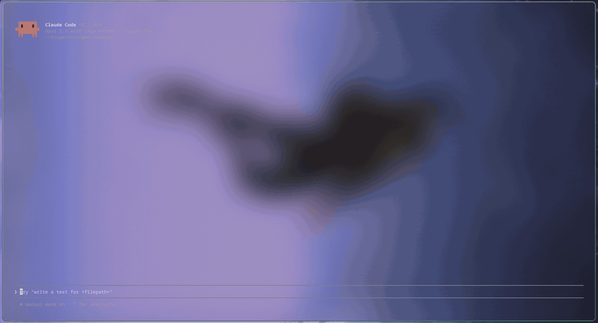

# ventana

*[Leer en español](README.es.md)*



A Claude Code mod for Linux that opens a native window next to your terminal. You keep working with Claude in the terminal as usual. The window shows the chat and what is happening in the session, and you can also type to Claude from it.

It does not replace the terminal and does not start a second Claude. It attaches to the session you are already running, so the terminal and the window always show the same conversation.

Type `/ventana` in a session to open it, or start everything at once with the `claude-ventana` command (see [Launcher](#launcher)).

> The interface is in Spanish.

## Features

- **Chat:** your messages and Claude's replies. What you type there is sent as if you typed it in the terminal. While Claude works, the ■ button stops it, like Esc in the terminal. Includes editable shortcuts.
- **Agents:** when Claude launches subagents, a panel slides in from the right. Each agent is a little robot beamed down from Claude that works, waits or finishes in front of you. Its card shows what it is doing right now, the last thing it wrote, its tools, its context and the tokens it wrote, plus its brief and its reply.
- **Permissions and questions:** when Claude asks for permission, asks a multiple-choice question or finishes a plan, a card shows up in the window so you can answer there, with a preview of the command or the edit. If the window is closed, you do not answer within 5 minutes, or you pick "Responder en la terminal", the question goes to the terminal as usual.
- **Activity:** every tool Claude uses, live. In a wide window it is a side panel; in a narrow window it shows inside the chat, like in the terminal.
- **Attachments:** paste images or files with Ctrl+V, drag them in, or use the + button. They are saved to `~/.cache/claude-ventana/adjuntos` (deleted after 7 days) and the message gives Claude their path.
- **Images from Claude:** when Claude names an image file in a reply (a screenshot it took, a chart it made), the window shows it under the text. Click any image to see it full size. The server only serves image files whose path Claude wrote in a reply.
- **Command suggestions:** type `/` in the chat to see the available commands, like in the terminal.
- **Hide the terminal:** a button hides and shows the terminal Claude runs in. It comes back by itself when a question moves to the terminal and when you close the window.
- **Sessions:** the Claude sessions open right now and your projects with their recent conversations. Bring an open session's terminal to the front, resume a past conversation, or start a new one in any project.
- **Side panel:** the top-left button (or Ctrl+B) slides in a panel with the tabs, the permission mode and model, the terminal button and your remaining usage.
- **Mode and model:** pick the permission mode (Normal, Accept edits, Plan, Auto, Don't ask) and the model, like in `/config`.
- **Remaining usage:** how much is left in each usage window and when it resets. At 15 % or less, the panel button shows a red dot.
- **Usage:** session duration, cost, model, context fill, account limits and the last turn's tokens.
- **Mods:** your installed plugins with a switch to turn each one on and off. The change applies with `/reload-plugins`.

## What works where

The core of the window works on any Linux desktop. A few extras move windows around, and those need Hyprland and kitty.

| Feature | Any desktop (GNOME, KDE, Sway…) | Hyprland | Needs kitty |
|---|:-:|:-:|:-:|
| Chat, agents, permissions, questions, activity | ✅ | ✅ | |
| Attachments, command suggestions, shortcuts | ✅ | ✅ | |
| Mode, model, usage, remaining usage, mods | ✅ | ✅ | |
| List open sessions and past conversations | ✅ | ✅ | |
| Hide and show the terminal | ❌ (button not shown) | ✅ | ✅ |
| Bring an open session's terminal to the front | ❌ | ✅ | |
| Resume or start a session from the window | ✅ | ✅ | ✅ |
| Launcher from the app menu | ✅ | ✅ | ✅ |

Tested on Hyprland 0.57 (Lua config) on Wayland, with Claude Code 2.1.322.

## Requirements

- Linux with a graphical desktop.
- [`bun`](https://bun.sh) on your `PATH`, for the local server.
- `python3` with PySide6 and Qt WebEngine, for the window. On Arch and derivatives: `sudo pacman -S pyside6 qt6-webengine`. **Heads-up:** these are big, around 350 MB installed, more if you do not already have Qt 6. With pip it is similar: `pip install PySide6`.
- Optional: Hyprland and [kitty](https://sw.kovidgoyal.net/kitty/) for the extras in the table above.

## Install

At the prompt of a terminal session:

```
/plugin install ventana --marketplace engell26/claude-ventana
```

Answer `y` to add the marketplace and choose the scope (user scope makes it available in all your sessions).

From a shell:

```
claude plugin install ventana --marketplace engell26/claude-ventana
```

## Launcher

The launcher is an optional command that opens Claude with the window already open. Installing the plugin does not set it up, and Claude Code keeps the plugin in a folder whose name changes with each version, so clone the repo to get it:

```
git clone https://github.com/engell26/claude-ventana ~/claude-ventana
ln -s ~/claude-ventana/lanzador/claude-ventana ~/.local/bin/claude-ventana
cp ~/claude-ventana/lanzador/claude-ventana.desktop ~/.local/share/applications/
```

`~/.local/bin` must be on your `PATH`. In a terminal, `claude-ventana` runs Claude right there. From the app menu it opens kitty with Claude inside. By default the terminal hides when the window opens; you can change that in the side panel. A `git pull` in `~/claude-ventana` updates the launcher.

## How it works

Three pieces:

1. `hooks/register.ts`: the mod. It only observes the session: no hook blocks or changes what Claude does, so if the window or the server fail, the session goes on as usual.
2. `app/server.ts`: a local server the mod starts with `bun` when you type `/ventana`. It shuts itself down a minute after the window closes.
3. `app/window.py` and `app/index.html`: the Qt window and the page it shows.

## Security

- The server listens only on `127.0.0.1`, on a different port for each session.
- Every request needs a random per-session token. The server checks the `Host` and `Origin` headers, so a website open in your browser cannot reach it, not even through DNS rebinding.
- The token reaches the window through an environment variable, not the command line, so other users on the machine cannot read it with `ps`.
- Markdown is escaped before it is turned into HTML, and the page loads nothing from the internet.
- Before the first plugin change, a copy of `~/.claude/settings.json` is saved as `settings.json.antes-de-ventana`.

Shortcuts are saved in `~/.config/claude-ventana/atajos.json`.

## Note

Claude Code's mod API is in early access and may change between versions. This mod was written against Claude Code 2.1.322.

## License

MIT. See [LICENSE](LICENSE).
